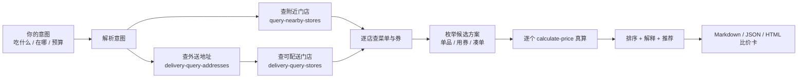

# 麦麦到手价 · mcd-final-price

> 同一顿麦当劳，外送到手 vs 下楼自取，差多少钱、差多少时间，一次算清。


**麦麦到手价**是一个基于麦当劳中国 MCP 的比价 Skill。你说想吃什么、在哪，它把附近门店自取和麦乐送到手的所有费用算完，告诉你今天这顿该怎么点。

不是又一个“领券大全”，也不是让模型猜一个套餐。**每一个价格都来自官方 `calculate-price`，每一张券都真实试算；算不出来就不推荐。**

---

## 10 秒看懂

```text
你：我在上海人民广场，想吃双层吉士堡套餐，现在点。

麦麦到手价：

推荐   到店自取 · 南京东路店      ¥27.50    步行 6 分钟 + 取餐约 5 分钟
对比   到店自取 · 人民广场店      ¥31.00    步行 3 分钟 + 取餐约 5 分钟
对比   麦乐送 · 送至公司          ¥36.50    预计 35 分钟送达

结论：方案 A 比外送省 ¥9.00，代价是下楼 + 取餐约 11 分钟。
      如果你走不开，选外送：多花 ¥9.00，换 35 分钟送上门。
```

| 方案 | 取餐方式 | 商品 | 优惠 | 配送/包装 | 到手价 | 时间 |
|---|---|---|---:|---:|---:|---|
| A | 到店自取 · 南京东路店 | 双层吉士堡套餐 ×1 | -¥5.00 | ¥0.00 | **¥27.50** | 约 11 分钟 |
| B | 到店自取 · 人民广场店 | 双层吉士堡套餐 ×1 | 无 | ¥0.00 | ¥31.00 | 约 8 分钟 |
| C | 麦乐送 · 送至公司 | 双层吉士堡套餐 ×1 | -¥4.00 | +¥7.00 | ¥36.50 | 约 35 分钟 |

> 以上为演示数据，仅用于展示输出形态。实际价格以 `calculate-price` 返回和麦当劳官方结算页为准。

### 真机输出（2026-10-23，上海人民广场）

```text
正在查询 上海 人民广场 附近门店…
正在查询外送地址与可配送门店…
正在逐个调用 calculate-price 真算（3 个候选）…
算价完成：3/3 个方案成功。
```

| 门店 | 取餐方式 | 商品 | 优惠 | 配送/包装 | 到手价 | 时间 |
|---|---|---|---:|---:|---:|---:|
| 麦当劳上海黄浦华旭国际大厦餐厅 | 到店自取 | 巨无霸 ×1 | 无 | — | **¥25.50** | 约 7 分钟（估算） |
| 麦当劳上海福州路餐厅 | 到店自取 | 巨无霸 ×1 | 无 | — | **¥25.50** | 约 8 分钟（估算） |
| 麦当劳上海食品一店餐厅 | 到店自取 | 巨无霸 ×1 | 无 | — | **¥26.50** | 约 10 分钟（估算） |

> 测试账号没有保存外送地址，本次自动降级为只比到店，并明确提示。外送链路已通过单元测试，待账号有地址后可直接实测。

---

## 它解决什么问题

- **外送和自取，差的不只是一个配送费。** 起送价、包装费、配送费、门店券、外送券、不同门店的菜单价，每一项都在变。
- **附近三家店，可能三个价。** 同样的套餐，A 店有满减、B 店没有，C 店更近但更贵。
- **券要试了才知道能不能用。** 券面写着“满 30 减 8”，但你的套餐可能不适用；只有真实算价才算数。
- **时间也是成本。** 省 9 块多走 3 分钟值不值，应该由你决定，而不是被 App 的默认选项替你做决定。

## 它不是什么

- 不是优惠券聚合页：只算你**这一单**能用的券，不堆券库。
- 不是自动下单机器人：默认**只读比价**，不领券、不下单、不碰支付。
- 不是“AI 估价”：所有金额来自 MCP 的 `calculate-price`，引擎只做归一化、比较和排序，不做价格猜测。
- 不是游戏或抽奖：它只回答一个很具体的问题——这顿怎么点更划算。

---

## 核心能力

| 能力 | 说明 |
|---|---|
| 到店 vs 外送 | 同一份餐，分别计算自取和麦乐送的到手价 |
| 多门店比价 | 附近 3 家门店逐一询价，门店券差异一目了然 |
| 券后真算 | 候选券逐个交给 `calculate-price` 试算，失败即淘汰 |
| 凑单临界点 | 差几块钱能触发满减？加购后是更贵还是更便宜？ |
| 时间折算 | 可选 `--value-time`，把你的时间价值折算进决策 |
| 可解释 | 每个方案列出商品、券、配送费、包装费和最终价 |
| 只读安全 | 不自动领券、不下单；Token 只从环境变量读取 |

---

## 快速开始

### 1. 准备

- Node.js 20+
- 麦当劳 MCP Token：在 [open.mcd.cn/mcp](https://open.mcd.cn/mcp) 注册获取
- 一个已保存的外送地址（可选；没有就只比到店）

### 2. 安装

```bash
git clone https://github.com/yeheheheh/mcd-final-price.git
cd mcd-final-price
npm install
cp .env.example .env
# 编辑 .env，填入 MCD_MCP_TOKEN
```

### 3. 先看演示（不需要 Token）

```bash
npm run demo
```

演示使用 `src/demo/scenario.json` 中的录制数据，不连接 MCP、不产生任何真实查询。

### 4. 真实比价

```bash
npm run compare -- \
  --intent "双层吉士堡套餐" \
  --city "上海" \
  --keyword "人民广场" \
  --address-id "你的外送地址ID"
```

输出 JSON：

```bash
npm run compare -- ... --json
```

生成可截图分享的比价卡：

```bash
npm run compare -- ... --html report.html
```

### 5. 在 WorkBuddy 里用

把 `skills/mcd-final-price/` 放进 WorkBuddy 的 Skills 目录，按 [workbuddy.md](workbuddy.md) 配置 MCP，然后直接说：

> 我在上海人民广场，想吃双层吉士堡套餐，帮我看看现在外送和到店哪个划算。

本项目使用 WorkBuddy 完成需求拆解、MCP 接口探测、Skill 调试与文档整理；完整的开发过程和配置方式记录在 [workbuddy.md](workbuddy.md)。

---

## 它是怎么算的



**关键原则：LLM 负责理解，引擎负责算账。**

- Agent 只做三件事：听懂你想吃什么、找到门店和地址、调用工具。
- 所有金额归一化为“分”，由确定性引擎比较；不让模型做算术。
- 每个候选方案都必须经过 `calculate-price`；接口报错或券不可用，直接淘汰，不猜。
- 输出带数据时间戳；价格、菜单、库存以官方实时结果为准。

### 用到的 MCP 工具

| 工具 | 用途 |
|---|---|
| `now-time-info` | 判断当前时段，避免推荐已打烊或不在售的早餐（可选） |
| `query-nearby-stores` | 找到附近可自取门店 |
| `delivery-query-addresses` | 读取用户已保存的外送地址 |
| `delivery-query-stores` | 找到该地址可配送的门店 |
| `query-meals` | 读取门店菜单和商品编码 |
| `query-meal-detail` | 查看套餐组成 / 可选特制（按需） |
| `query-store-coupons` | **主券源**：当前门店 + 取餐方式可用券，含 `couponId` |
| `calculate-price` | **唯一算价口径**：逐方案试算应付金额 |

说明：

- `query-my-coupons` 只用于展示，不作为算价依据；2026-10-23 实测它返回 Markdown，没有 `couponId`。
- `available-coupons` 预留在只读白名单中，本项目不自动领取。
- 本项目不调用 `create-order`、`cancel-order`、`auto-bind-coupons` 等写操作，不涉及支付。需要下单时，请回到麦当劳官方 App / 小程序。

---

## 比价口径

**到手价 = 商品应付 + 配送费 + 包装费 + 餐具费 - 优惠**

以 `calculate-price` 返回的 `data.price`（分）为准；若接口将费用单列，会展示明细。到店自取没有配送费/包装费，外送按实际返回计算。

- **金额单位**：`calculate-price` 返回分，菜单 `currentPrice` 是元字符串；内部统一转整数分，展示时转元，避免浮点误差。
- **券**：只使用 `query-store-coupons` 返回且 `calculate-price` 实际接受的券；`couponId` / `couponCode` 放在 `items[]` 内，不自动领券。
- **不猜券**：券的 `products[].productCode` 不包含目标商品时直接跳过；最终优惠以算价接口为准。
- **响应解析**：MCP 返回“文字说明 + JSON”，适配层提取 `{"success": ...}` 顶层对象；`query-my-coupons` 实测只有 Markdown、没有券 ID，因此不作为算价依据。
- **凑单**：只枚举少量高价值候选（如差 1–5 元触发满减），不做无限组合；每个候选都必须真实算价。
- **时间**：优先使用接口返回的预计时间；没有则按距离估算，并明确标注“估算”。
- **时间价值**：`--value-time 60` 表示你的时间价值为 60 元/小时。引擎只折算**你需要离开工位或排队占用的时间**，不把外送的等待时间算成成本；同时展示“按钱排序”和“按时间价值排序”，不替你做价值判断。

### 为什么不用“菜单价相加”？

因为菜单价不等于到手价：券是否可用、配送费、包装费、起送价、门店差异，只有 `calculate-price` 知道。我们宁可少算一个方案，也不输出一个看起来合理、实际却下不了单的价格。

---

## 安全与边界

- **只读**：不调用 `create-order`、`auto-bind-coupons`、`mall-create-order` 等写操作。
- **不碰支付**：不收集支付信息，不生成支付链接。
- **Token 安全**：只从 `MCD_MCP_TOKEN` 环境变量读取；仓库不含真实 Token；`.env` 已加入 `.gitignore`。
- **不编造**：价格、券、营业状态全部来自 MCP 返回；接口失败时明确说“算不出来”，不给假推荐。
- **非官方**：本项目是参赛作品，非麦当劳官方产品；输出仅供参考，价格以官方渠道为准。

---

## 项目结构

```text
mcd-final-price/
├── README.md
├── CONTEST_DECLARATION.md      # 官方参赛声明（不可修改）
├── MCP_INTEGRATION.md          # MCP 接入、真实 schema 与调用顺序
├── mcp-config.example.json     # MCP 客户端配置示例
├── .env.example                # Token 占位符（不含真实密钥）
├── .gitignore                  # 忽略 .env / node_modules / 报告产物
├── workbuddy.md                # WorkBuddy 安装与使用说明
├── LICENSE
├── package.json
├── tsconfig.json
├── skills/
│   └── mcd-final-price/
│       └── SKILL.md            # Skill 指令、只读白名单与输出规范
├── src/
│   ├── cli.ts                  # demo / compare 命令
│   ├── probe.ts                # 只读 schema 探测
│   ├── env.ts                  # .env 加载（不覆盖已有环境变量）
│   ├── domain/
│   │   └── types.ts            # 领域类型
│   ├── mcp/
│   │   ├── client.ts           # Streamable HTTP + 只读白名单
│   │   └── mcd.ts              # 麦当劳工具封装
│   ├── compare/
│   │   ├── normalize.ts        # 混合文本 JSON 提取、分/元归一化
│   │   ├── candidates.ts       # 餐品匹配、券过滤、凑单
│   │   ├── rank.ts             # 排序、时间估算、时间成本
│   │   ├── report.ts           # Markdown / JSON / HTML 报告
│   │   └── live.ts             # 真实 MCP 编排与降级
│   └── demo/
│       ├── run.ts              # 离线演示流水线
│       └── scenario.json       # 演示数据（非真实价格）
└── tests/                      # 53 项单元 / 集成测试
```

> 2026-10-23 已完成真实 MCP 只读链路验证：35 个工具可连接，上海人民广场 3 家门店成功算价，53 项测试通过。外送链路因测试账号没有地址，暂未真机验证，已用单元测试覆盖参数结构。

---

## 本地开发与测试

```bash
npm run demo       # 离线演示（不需要 Token）
npm run compare    # 真实比价（需要 Token）
npm test           # 53 项测试（不需要 Token）
npm run typecheck  # 类型检查
npm run probe      # 探测 MCP 工具 schema（需要 Token）
```

`npm run probe -- --full` 会打印关键工具的完整入参 schema；`npm run probe` 会额外验证附近门店和外送地址读取。它不会创建订单，也不会领取优惠券。

---

## 已知限制

- `query-my-coupons` 实测只返回 Markdown，没有 `couponId`；本项目改用 `query-store-coupons` 作为算价券源。
- 外送比价需要账号下已有可配送地址；当前验证账号为 0 个地址，因此外送链路只完成了单元测试，尚未真机算价。没有地址时只比到店，不伪造地址。
- 自取时间是按距离估算（80 米/分钟 + 5 分钟取餐），不是官方承诺；外送 ETA 只有接口返回时才展示。
- 不同门店的商品编码/可售状态可能不同，必须逐店查询；这会带来多次工具调用（会控制在官方 600 次/分钟限制内）。
- 券的叠加规则由官方算价接口决定；本项目不做“规则猜测”。
- 仅支持中国大陆麦当劳 MCP 覆盖的场景；不处理跨城、团餐、企业发票等特殊流程。
- 目前不自动下单；这是安全选择，不是能力缺失。

## Roadmap

- [x] 到店 vs 外送比价（外送路径单元测试通过，真机待地址）
- [x] 多门店 + 券后真算
- [x] 凑单临界点
- [x] 时间价值折算
- [x] JSON / Markdown / HTML 输出
- [x] WorkBuddy Skill（手动安装）
- [x] 真机到店比价（上海人民广场，3 家门店）
- [ ] 外送真机验证（需要账号保存一个配送地址）
- [ ] 外送 ETA 真机校准
- [ ] WorkBuddy 一键安装包
- [ ] 团队拼单分摊（多人多口味）
- [ ] 订单状态追踪（在用户明确授权后）

---

## 参赛信息

- 赛事：2026 麦当劳程序员创意开发大赛
- 时间：2026-10-09 10:30 至 2026-10-25 23:59
- 提交：公开 GitHub 仓库 + Issue 报名
- 声明：见 [CONTEST_DECLARATION.md](CONTEST_DECLARATION.md)
- MCP 接入：见 [MCP_INTEGRATION.md](MCP_INTEGRATION.md)
- WorkBuddy 使用：见 [workbuddy.md](workbuddy.md)

Issue 标题格式：

```text
【参赛申请】麦麦到手价
```

Issue 内容：

```text
项目名称：麦麦到手价
项目地址：https://github.com/yeheheheh/mcd-final-price
项目简介：基于麦当劳中国 MCP 的外送 vs 到店实时比价 Skill，逐方案调用 calculate-price 真算到手价，给出可解释的下单前建议。
```

> 提交前把 `<your-name>` 替换成你的 GitHub 用户名，确认仓库公开，并确保 Star > 0 入榜。

## 如果它帮你省到钱

点一个 Star。Star 是这次比赛的排名依据，也能让更多每天中午纠结“下楼还是外送”的人看到它。

## License

MIT
